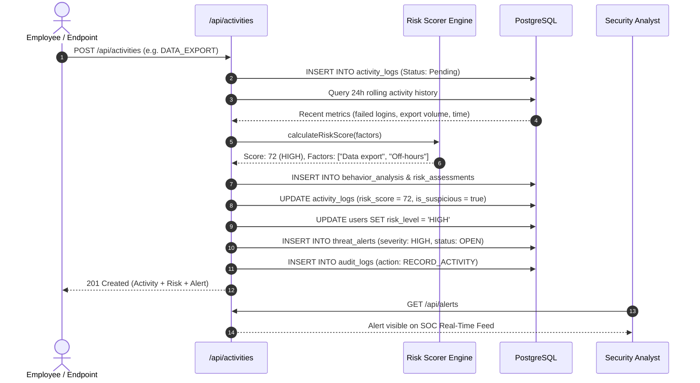

# SentinelFlow – System Architecture Specification

## 1. Executive Architectural Overview

SentinelFlow is an **Intelligent Insider Threat Detection and Risk Analysis Platform** architected as a high-throughput, multi-tier security monitoring application. It bridges the gap between raw endpoint telemetry and actionable SOC (Security Operations Center) intelligence by continuously aggregating user activities, evaluating behavioral deviations against policy baselines, scoring multi-factor risk, and automating threat alert dispatch.

```mermaid
graph TD
    subgraph Client Tier [SOC Frontend - React 19 + Vite]
        UI[SOC Security Console]
        AuthCtx[JWT Auth Context & RBAC Guard]
        Views[Dashboards / Alerts / Cases / Audit / Telemetry]
        UI --> AuthCtx
        AuthCtx --> Views
    end

    subgraph Service Tier [API Gateway & Backend Services - Node.js Express]
        Router[Express REST API Gateway]
        AuthMW[Token & Role Middleware]
        
        subgraph Core Engines
            Ingestion[Activity Telemetry Ingestion]
            RiskEngine[Deterministic Risk Scoring Engine]
            ThreatEngine[Automated Rule & Anomaly Detector]
            CaseManager[Forensic Investigation Manager]
            AuditLogger[Immutable Security Audit Ledger]
        end
        
        Router --> AuthMW
        AuthMW --> Ingestion
        Ingestion --> RiskEngine
        RiskEngine --> ThreatEngine
        ThreatEngine --> CaseManager
        Ingestion --> AuditLogger
    end

    subgraph Persistence Tier [PostgreSQL 14+ Relational Engine]
        DB[(PostgreSQL Database)]
        TablesUser[users & roles]
        TablesTelemetry[devices, network_sessions, activity_logs]
        TablesAnalytics[behavior_analysis, risk_assessments]
        TablesIncident[threat_alerts, investigation_cases, investigation_findings]
        TablesGovernance[policies, detection_rules, security_reports, audit_logs]
        
        DB --- TablesUser
        DB --- TablesTelemetry
        DB --- TablesAnalytics
        DB --- TablesIncident
        DB --- TablesGovernance
    end

    Views -- HTTPS REST / JSON --> Router
    Core Engines -- pg Connection Pool --> DB
```

---

## 2. Multi-Tier Architectural Layers

### Tier 1: Presentation Layer (React 19 + Vite)
- **Role-Aware Navigation**: Dynamically renders views based on the authenticated principal's role (`admin`, `analyst`, `employee`).
- **SOC Dark Theme**: High-contrast, glassmorphic cybersecurity aesthetic with immediate situational awareness badges (`CRITICAL`, `HIGH`, `MEDIUM`, `LOW`).
- **Telemetry & Reporting Dashboards**: Interactive metrics tracking open alerts, ongoing forensic cases, risk velocity, and audit compliance.

### Tier 2: Application & API Layer (Node.js & Express)
- **Authentication & RBAC Middleware**: Verifies HS256 JWT tokens and validates role privileges at every endpoint.
- **Centralized Error Handling**: Ensures fault tolerance and uniform error envelopes.
- **Auditing Hook**: Captures actor metadata (IP, user agent, actor ID, action type, before/after states) across all state-modifying actions.

### Tier 3: Core Analytics & Detection Layer
1. **Behavioral Analysis Subsystem**: Analyzes 24-hour rolling windows for:
   - Volume velocity spikes
   - Off-hours logins (outside 08:00–18:00)
   - Consecutive authentication failures
   - Sensitive database / file access patterns
   - Unrecognized device or foreign subnet connections
2. **Deterministic Risk Scorer (`riskScorer.js`)**:
   - Computes normalized scores from `0` to `100`.
   - Assigns categorical risk tiers:
     - `0 - 29`: **LOW**
     - `30 - 59`: **MEDIUM**
     - `60 - 79`: **HIGH**
     - `80 - 100`: **CRITICAL**
   - Emits structured JSON factors detailing exact point additions.
3. **Automated Threat Detector (`threatDetector.js`)**:
   - Triggers automated incident alerts for activities with risk scores $\ge 30$.
   - Links the detected threat directly to the originating activity log and user assessment.

### Tier 4: Persistence Layer (PostgreSQL)
- **ACID Compliance**: Ensures strong transactional consistency for sensitive investigations and audit records.
- **Referential Integrity**: Cascading constraints across users, devices, sessions, alerts, and cases.
- **JSONB Querying**: Flexible semi-structured storage for policy definitions, detection parameters, and dynamic factor arrays.
- **Optimized B-tree Indexing**: Indices on `user_id`, `created_at`, `status`, and `actor_id` for sub-millisecond retrieval under large log volumes.

---

## 3. End-to-End Activity Ingestion & Triage Pipeline



---

## 4. Role-Based Access Control (RBAC) Matrix

| Resource / Function | Employee | Security Analyst | Administrator |
|---------------------|:--------:|:----------------:|:-------------:|
| View Personal Telemetry | ✅ | ✅ | ✅ |
| Submit Endpoint Activity | ✅ | ✅ | ✅ |
| View SOC Dashboard | ❌ (Own only) | ✅ | ✅ |
| Triage Alerts (`OPEN` $\to$ `RESOLVED`) | ❌ | ✅ | ✅ |
| Open Forensic Investigations | ❌ | ✅ | ✅ |
| Add Investigation Evidence & Notes | ❌ | ✅ | ✅ |
| Generate Security & Incident Reports | ❌ | ✅ | ✅ |
| Manage System Users & Roles | ❌ | ❌ | ✅ |
| Configure Detection Policies & Thresholds | ❌ | ❌ | ✅ |
| Access Immutable System Audit Logs | ❌ | ❌ | ✅ |

---

## 5. Security & Threat Mitigation Architecture

1. **Password Protection**: BCrypt key derivation with 10 salt rounds.
2. **Stateless API Tokens**: Standard JSON Web Tokens (JWT) signed with HMAC-SHA256, carrying expiration TTLs.
3. **SQL Injection Defense**: Parameterized queries via `pg` driver across 100% of controller handlers.
4. **Audit Trail Immutability**: Dedicated `audit_logs` table designed without update or deletion endpoints.
5. **CORS Enforcement**: Explicit origin whitelisting restricting API access to the approved frontend origin (`http://localhost:5173`).
