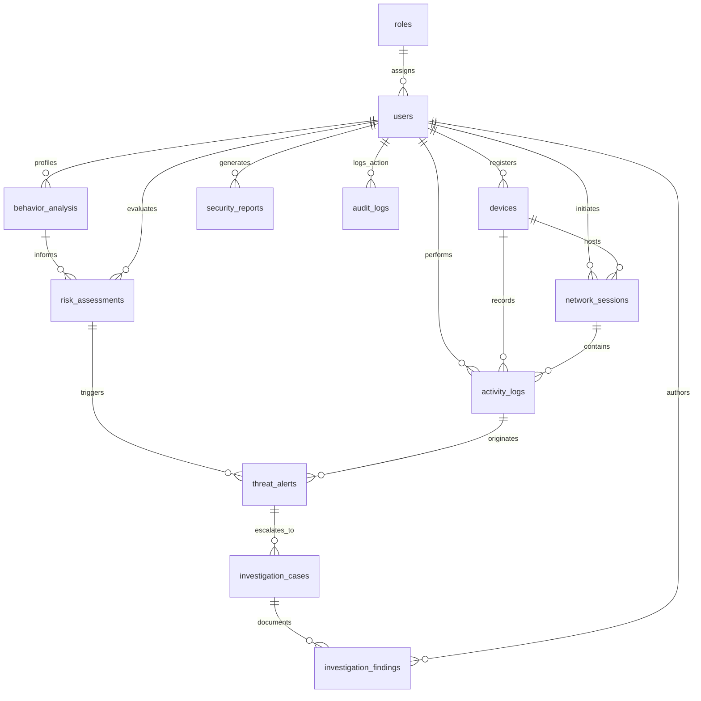

# SentinelFlow Database Design & Data Dictionary

## 1. Entity Relationship Overview

The SentinelFlow database schema is built on **PostgreSQL 14+** to guarantee ACID compliance, relational integrity, and high performance for streaming security telemetry.

---

## 2. Table Dictionaries

### 2.1 `roles`
Stores authorization role tiers.
- `id` (SERIAL, PK)
- `name` (VARCHAR(50), UNIQUE) - `employee`, `analyst`, `admin`
- `description` (TEXT)
- `created_at` (TIMESTAMP)

### 2.2 `users`
Core user identity ledger with behavioral risk level tracking.
- `id` (SERIAL, PK)
- `username` (VARCHAR(100), UNIQUE, NOT NULL)
- `email` (VARCHAR(255), UNIQUE, NOT NULL)
- `password_hash` (VARCHAR(255), NOT NULL) - BCrypt 10 rounds
- `full_name` (VARCHAR(255), NOT NULL)
- `role_id` (INTEGER, FK -> `roles.id`, NOT NULL)
- `department` (VARCHAR(100))
- `status` (VARCHAR(20), CHECK `active`, `inactive`, `suspended`)
- `risk_level` (VARCHAR(20), CHECK `LOW`, `MEDIUM`, `HIGH`, `CRITICAL`)
- `last_login` (TIMESTAMP)
- `created_at`, `updated_at` (TIMESTAMP)

### 2.3 `devices`
Workstations, laptops, and endpoints monitored by SentinelFlow.
- `id` (SERIAL, PK)
- `user_id` (INTEGER, FK -> `users.id`)
- `device_name` (VARCHAR(255), NOT NULL)
- `device_type` (VARCHAR(50), CHECK `laptop`, `workstation`, `mobile`, `server`, etc.)
- `os_type` (VARCHAR(100))
- `mac_address` (VARCHAR(17))
- `ip_address` (VARCHAR(45))
- `status` (VARCHAR(20), CHECK `active`, `inactive`, `blocked`)
- `is_registered` (BOOLEAN, DEFAULT true)

### 2.4 `network_sessions`
Active and historical network connections.
- `id` (SERIAL, PK)
- `user_id` (INTEGER, FK -> `users.id`)
- `device_id` (INTEGER, FK -> `devices.id`)
- `session_token` (VARCHAR(255))
- `ip_address` (VARCHAR(45))
- `login_time` (TIMESTAMP)
- `logout_time` (TIMESTAMP)
- `duration_minutes` (INTEGER)
- `status` (VARCHAR(20), CHECK `active`, `ended`, `expired`, `forced_logout`)

### 2.5 `activity_logs`
High-frequency telemetry stream capturing user/device interactions.
- `id` (SERIAL, PK)
- `user_id` (INTEGER, FK -> `users.id`)
- `device_id` (INTEGER, FK -> `devices.id`)
- `session_id` (INTEGER, FK -> `network_sessions.id`)
- `activity_type` (VARCHAR(50), NOT NULL, CHECK `LOGIN`, `LOGOUT`, `FILE_ACCESS`, `FILE_DOWNLOAD`, `DATA_EXPORT`, `NETWORK_ACCESS`, `PRIVILEGED_ACTION`, `POLICY_CHANGE`, `FAILED_LOGIN`, `DEVICE_LOGIN`, `SUSPICIOUS_ACTIVITY`, `OTHER`)
- `resource` (VARCHAR(500))
- `source_ip` (VARCHAR(45))
- `status` (VARCHAR(20), CHECK `success`, `failed`, `blocked`, `flagged`)
- `risk_score` (INTEGER, 0-100)
- `is_suspicious` (BOOLEAN, DEFAULT false)
- `metadata` (JSONB)
- `created_at` (TIMESTAMP)

### 2.6 `behavior_analysis`
Aggregated statistical profile per user window.
- `id` (SERIAL, PK)
- `user_id` (INTEGER, FK -> `users.id`, NOT NULL)
- `analysis_period` (VARCHAR(50), DEFAULT 'daily')
- `total_activities` (INTEGER)
- `failed_logins` (INTEGER)
- `unusual_time_logins` (INTEGER)
- `sensitive_resource_accesses` (INTEGER)
- `policy_violations` (INTEGER)
- `data_exports` (INTEGER)
- `flags` (JSONB)
- `analyzed_at` (TIMESTAMP)

### 2.7 `risk_assessments`
Deterministic scoring result and factor breakdown.
- `id` (SERIAL, PK)
- `user_id` (INTEGER, FK -> `users.id`, NOT NULL)
- `behavior_analysis_id` (INTEGER, FK -> `behavior_analysis.id`)
- `risk_score` (INTEGER, CHECK 0-100)
- `risk_level` (VARCHAR(20), CHECK `LOW`, `MEDIUM`, `HIGH`, `CRITICAL`)
- `contributing_factors` (JSONB, NOT NULL)
- `assessed_at` (TIMESTAMP)

### 2.8 `threat_alerts`
Security events dispatched to the SOC analyst queue.
- `id` (SERIAL, PK)
- `title` (VARCHAR(500), NOT NULL)
- `description` (TEXT)
- `user_id` (INTEGER, FK -> `users.id`)
- `risk_assessment_id` (INTEGER, FK -> `risk_assessments.id`)
- `source_activity_id` (INTEGER, FK -> `activity_logs.id`)
- `severity` (VARCHAR(20), CHECK `LOW`, `MEDIUM`, `HIGH`, `CRITICAL`)
- `risk_score` (INTEGER)
- `status` (VARCHAR(30), CHECK `OPEN`, `ACKNOWLEDGED`, `UNDER_INVESTIGATION`, `RESOLVED`, `FALSE_POSITIVE`)
- `rule_triggered` (VARCHAR(255))
- `created_at`, `updated_at` (TIMESTAMP)

### 2.9 `investigation_cases`
SOC investigation case files.
- `id` (SERIAL, PK)
- `case_number` (VARCHAR(50), UNIQUE, NOT NULL) - e.g. `CASE-20261010-0001`
- `alert_id` (INTEGER, FK -> `threat_alerts.id`)
- `assigned_analyst_id` (INTEGER, FK -> `users.id`)
- `title` (VARCHAR(500), NOT NULL)
- `description` (TEXT)
- `priority` (VARCHAR(20), CHECK `LOW`, `MEDIUM`, `HIGH`, `CRITICAL`)
- `status` (VARCHAR(30), CHECK `OPEN`, `IN_PROGRESS`, `PENDING_REVIEW`, `RESOLVED`, `CLOSED`)
- `resolution` (TEXT)
- `created_by` (INTEGER, FK -> `users.id`)

### 2.10 `investigation_findings`
Forensic notes and evidentiary attachments.
- `id` (SERIAL, PK)
- `case_id` (INTEGER, FK -> `investigation_cases.id`, NOT NULL)
- `analyst_id` (INTEGER, FK -> `users.id`)
- `finding_type` (VARCHAR(50), CHECK `NOTE`, `EVIDENCE`, `CONCLUSION`, `ACTION_TAKEN`)
- `content` (TEXT, NOT NULL)
- `created_at` (TIMESTAMP)

### 2.11 `security_reports`
Executive and technical summaries.
- `id` (SERIAL, PK)
- `title` (VARCHAR(500), NOT NULL)
- `report_type` (VARCHAR(50), CHECK `SECURITY_SUMMARY`, `INCIDENT_REPORT`, `RISK_ASSESSMENT`, `COMPLIANCE`, etc.)
- `generated_by` (INTEGER, FK -> `users.id`)
- `content` (JSONB, NOT NULL)
- `summary` (TEXT)

### 2.12 `policies` & `detection_rules`
Access and data egress security boundaries.
- Stored rules evaluate thresholds for off-hours access, maximum export bytes, and forbidden file extensions.

### 2.13 `audit_logs`
Immutable administrative and security event ledger.
- `id` (SERIAL, PK)
- `actor_id` (INTEGER, FK -> `users.id`)
- `actor_username` (VARCHAR(100))
- `action` (VARCHAR(100), NOT NULL)
- `entity_type` (VARCHAR(100))
- `entity_id` (INTEGER)
- `description` (TEXT)
- `ip_address` (VARCHAR(45))
- `metadata` (JSONB)
- `created_at` (TIMESTAMP)

---

## 3. Database Indexes

To support high-throughput log ingestion and real-time dashboard aggregation:
- `idx_activity_logs_user_id` on `activity_logs(user_id)`
- `idx_activity_logs_created_at` on `activity_logs(created_at)`
- `idx_threat_alerts_user_id` on `threat_alerts(user_id)`
- `idx_threat_alerts_status` on `threat_alerts(status)`
- `idx_audit_logs_actor_id` on `audit_logs(actor_id)`
- `idx_audit_logs_created_at` on `audit_logs(created_at)`
- `idx_risk_assessments_user_id` on `risk_assessments(user_id)`
